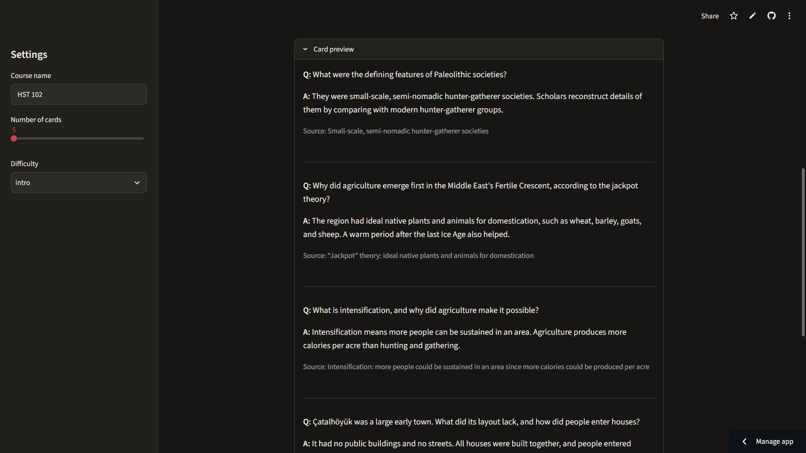

# Lecture → Flashcards

Turn messy lecture notes, PDFs, and YouTube transcripts into source-grounded flashcards you can review, study in the browser, and export to Anki.

**Live demo:** [Open the app](https://lecture-flashcards-ckr8hemndpmqnbx5tvz2eo.streamlit.app/)



**Built with:** Python, Streamlit, Claude API, pydantic, pypdf, genanki, pandas, pytest

## How it works

1. **Extract text** from a PDF (pypdf), a text file, or pasted notes or a transcript.
2. **Split into balanced chunks** of up to about 3,000 characters on paragraph boundaries, and send them to Claude in parallel (up to 8 at a time).
3. **Plan topics:** for each chunk, the model first lists every topic in the notes.
4. **Generate and validate:** the model writes one card per topic as JSON, which pydantic validates, with one retry that includes the error.
5. **Coverage follow-up:** the code finds topics with no card and asks for them in one follow-up request.
6. **Review and study:** edit cards in a table, then study them in a flip-card view.
7. **Export** to an Anki deck (`.apkg`) or CSV.

## Design decisions

- **Grounding with source quotes:** cards may only use the provided notes, and each one carries a short quote from them, so answers can be checked against the source.
- **Schema validation with retry:** every response must match a pydantic schema; on failure the exact error goes back to the model once, and a second failure shows a clear error.
- **Plan-then-write coverage, checked in code:** pydantic rejects any card whose topic isn't in the planned list, and the code requests cards for uncovered topics. Prompting alone didn't guarantee coverage.
- **Custom instructions treated as untrusted input:** the optional instructions are capped at 500 characters, sent in their own tagged block, and ranked below the core rules, so they can narrow focus but can't add outside facts or drop source quotes.
- **Cost control:** the API key lives in Streamlit secrets, and each request is capped at 80 cards in Auto mode, 40 in Custom, and 20 chunks (about 60,000 characters). Tags are built in code rather than by the model.
- **Per-run stats:** every API call records its tokens, duration, and type (first, retry, or follow-up), and each run shows its total time, token counts, and estimated cost. Open the app with `?debug=1` to see them.
- **Study view with escaped card text:** card text comes from the LLM and uploaded notes, so it reaches the page as escaped JSON and is set with `textContent`, never `innerHTML`.

## Results

- **HST 102 (19 slides), Auto mode:** balancing chunk sizes and running them in parallel cut generation time from 41 s to 25.7 s.
- **CSE 220 (28 pages, 8,883 characters):** content from the second half of the document is now covered; the original 6,000-character limit dropped it.

## Limitations and next steps

- No OCR, so scanned slides can't be read.
- Notes are limited to about 60,000 characters; anything beyond that is not used.
- Card types are sometimes mislabeled.
- Source quotes can be very short.
- **Next steps:** verify each source quote against the notes in code, and add spaced repetition.

## Run locally

Requires Python 3.10+ and an [Anthropic API key](https://platform.claude.com/).

```bash
git clone https://github.com/Kerem-Oncer/lecture-flashcards.git
cd lecture-flashcards
python -m venv .venv
source .venv/bin/activate      # Windows: .venv\Scripts\activate
pip install -r requirements.txt
```

Create `.streamlit/secrets.toml`:

```toml
ANTHROPIC_API_KEY = "your-key-here"
```

Then start the app:

```bash
streamlit run app.py
```

### Run the tests

The tests use a fake Claude client, so they need no API key or network. With the virtual environment activated:

```bash
.venv\Scripts\python -m pip install pytest      # macOS/Linux: pip install pytest
python -m pytest
```
